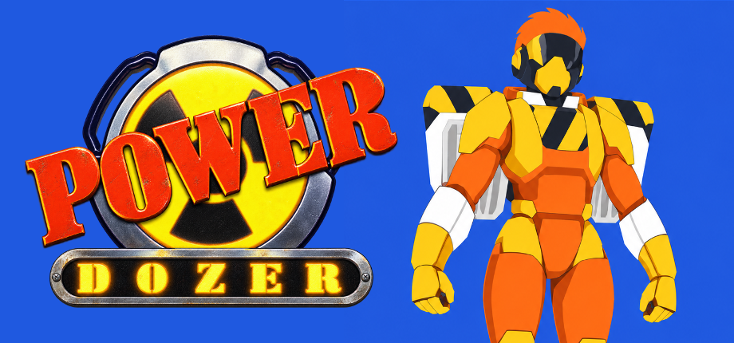
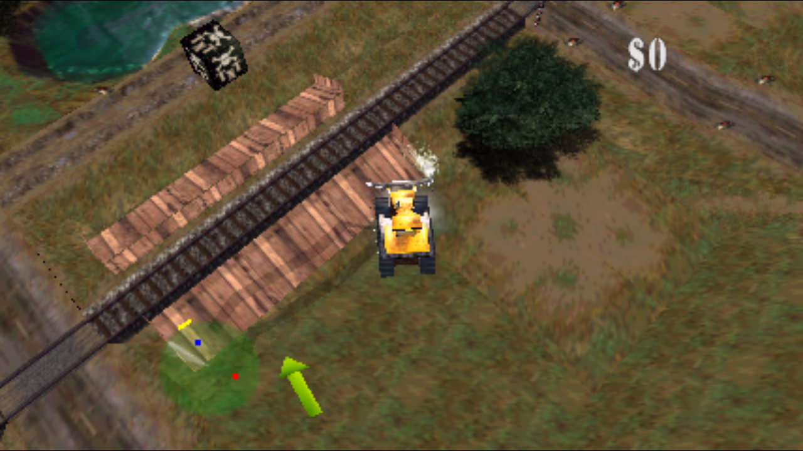

  

> This project was created with AI assistance. If that's not your cup of tea, feel free to move along.

# Power Dozer

**v0.84 — native Blast Corps beta candidate; Linux x86-64 and source preparation.**
Static recompilation of Blast Corps USA Rev 1 with N64Recomp,
N64ModernRuntime and RT64. The project is not affiliated with Rare or Nintendo.

  

## Download and play

Check the available archives and their SHA-256 checksums in
[Releases](https://github.com/djultra64/Power-Dozer/releases). Extract the runtime
archive into a writable folder:

- Linux: `power-dozer-v0.84-linux-x86_64.tar.gz`; run `Run Power Dozer.sh`.
- Source: v0.84 host code and pinned dependencies; see the build recipe below.
- Windows: `power-dozer-v0.84-windows-x86_64.zip`; run `Run Power Dozer.cmd`.

v0.84 adds a main menu before the original file selector: **Start Game**,
**PC Options** and **Close Game**, over the game's actual animated background
and scrolling ticker. Main keeps the original logo; pregame Settings conceals
it and retains Display, Graphics, Audio and all fourteen Controls actions above
the ticker. Resizing follows the active startup aspect, including letterboxing.
This candidate also repairs the initialized vehicle-shadow border and full-width
ticker medal sprites. The earlier settings, audio and wheel fixes remain included.
See [native scope and limits](docs/qa/main-menu-2026-10-11.md). Final archive audits
and merged checks precede publication; check Releases for actual availability.

On first launch, select your own **Blast Corps USA Rev 1** ROM.
z64/v64/n64 and ZIP files containing a single valid ROM are supported. The ROM is not included.

Requires Linux x86-64 with SSSE3/SSE4.1, Vulkan, X11 or XWayland,
glibc 2.38 or later, a C++ runtime with GLIBCXX_3.4.31 and zlib.
Windows requires x64, SSSE3/SSE4.1, Vulkan drivers and the
[Microsoft Visual C++ 2015–2022 x64 Redistributable](https://aka.ms/vs/17/release/vc_redist.x64.exe).
SDL and DXC libraries are included in the Linux runtime and prior Windows runtime.
[Installation, progress and requirements](docs/install.md).

## Options and controls

- Resolutions up to 4K, 16:9 presentation and an interpolation target of 120.
  Performance depends on the GPU and available refresh rate.
- **Alt+Enter** toggles fullscreen.
- Complete PC menu with Display, Graphics, Audio and Controls sections,
  mouse/keyboard/controller navigation and per-action remapping.
- Xbox, PlayStation, Switch and keyboard: names and glyphs follow the last
  active device. Switch retains B/A/Y/X according to their physical positions.
- Full-width menu background and ticker; aligned map vehicle sprites
  and glyphs extracted from the supplied atlas.
- Persistent EEPROM and Controller Pak progress, with recoverable backups.

| Default key | Action |
| --- | --- |
| Arrow keys | Move, steer and navigate |
| Z | Accelerate / confirm |
| X | Reverse / back |
| Enter | Start / pause |
| Left Shift | Stop / exit vehicle |
| I / J / K / L | Camera / C buttons |
| Q / E | L / R buttons |

You can remap each action in the PC menu. The manual selection
`--family xbox|playstation|switch` provides a fallback for ambiguous detection.

## Beta status

Startup, file selection, map, Simian Acres, movement,
pause, resume, restart, progress and input with virtual SDL controllers were verified.
The latest graphics test confirmed Switch and keyboard glyphs in the game.
Native Windows startup, Unicode saves/import and a brief interactive Vulkan
run with keyboard input also passed. See [v0.81 verification](https://github.com/djultra64/Power-Dozer/blob/main/docs/qa/release-v0.81.md)
for the observed scope and limitations. The wheel fix passed 138 Python tests,
46 Linux CTest checks, two Windows CTest checks and three-minute attract-mode
runs on both platforms; see
[v0.82 verification](docs/qa/release-v0.82.md).

v0.83 extends pending-audio recovery through the original graphics-yield path
and protects the soundplayer heartbeat from queue saturation and stale payloads.
Original guest protocol regressions verify dispatch, completion and reply;
the heartbeat fixtures verify both structural failure mechanisms. A ten-minute
Linux attract-mode run with real GPU/PulseAudio completed with
sustained audio-task activity. The native event that initiated the reported
heartbeat failure remains unconfirmed. These checks do not establish that every
intermittent dropout or gameplay hang is resolved.
Full level coverage, physical controllers and sustained 120 fps
remain for manual testing. End-of-level fades/sky and the
visual stability of the HUD arrow need further checking.
v0.84 is available for Linux and Windows. The Windows build passed eleven
checks and opened Main, Files and all four PC Settings sections before
returning to Main and exiting through Close Game. The shadow repair preserves the original silhouette and is supported
by actual texture-border/GPU evidence. The exact reported live 4K baseline was
not reproduced in the presented baseline, so this is not a claim that every
black ground line or display-specific symptom is resolved.

## Build and contribute

[Portable recipe and pinned dependencies](docs/build-source.md).
The release includes a source archive for the host and its dependencies.
Game code is generated locally from your ROM; packages do not
include a ROM, extracted overlays, saves or private recordings.

Project code uses GPL v3 or later; dependencies and control artwork
retain their provenance and notices. See [LICENSE](LICENSE), [NOTICE](NOTICE)
and `config/control-atlas.json`. The manifests document the limits of the
source and license review.

The function map builds on the work of
[retroplastic](https://github.com/retroplastic/blastcorps) and its continuation by
[SlaveOfIDO](https://github.com/SlaveOfIDO/blastcorps).

## AI Disclosure

I use **OpenAI Codex** to assist with research, reverse-engineering analysis, code implementation, debugging, tests, builds, packaging, and documentation. I direct that work, contribute code reviews and ideas for implementation, evaluate the game's behavior through hands-on testing, and decide which changes and releases to accept. Validation claims remain limited to the recorded builds and scenarios.

The original game and the upstream tools remain the work of their respective creators, credited in [CREDITS.md](CREDITS.md).

## Credits

See [CREDITS.md](CREDITS.md) for the projects, contributors and dependencies
used by Power Dozer, and the accompanying license notices.
