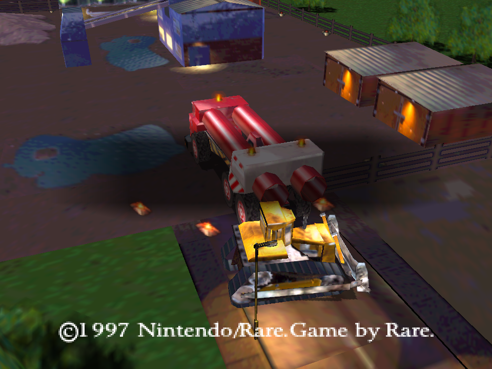

# Blast Corps: prototipo de viabilidad

Recompilación estática experimental de **Blast Corps USA Rev 1**. Ejecuta código
MIPS traducido a C++ con N64Recomp, N64ModernRuntime y RT64. La ROM suministrada
por el usuario aporta código, overlays y recursos. El arranque valida la ROM,
guarda una caché privada y genera los overlays en memoria; estos archivos no
se incluyen en los paquetes del proyecto.

Se han visto las intros, el título, una escena 3D del modo de demostración,
el mapa y Simian Acres, con movimiento, pausa, reanudación, misión completada
y conservación del progreso al reiniciar el proceso en pruebas aisladas.
También hay pruebas nativas de reconexión y acciones con mandos SDL virtuales.
El port sigue en desarrollo. Las presentaciones interpoladas medidas pasan el
objetivo de 120 fps en 720p y 1080p sobre una salida virtual de 120 Hz. En 4K,
la prueba sostenida quedó alrededor de 116,5 fps y no pasó el objetivo de 120.
Faltan la cobertura de misiones y las comprobaciones en una pantalla física.

La beta local del commit `99bb524` incluye las correcciones del runtime y una
reconstrucción comprobada con SDK independiente. El usuario acepta los gráficos
actuales. El mismo paquete pasó sesiones nativas de tres y seis minutos, pero
una sesión anterior dejó de procesar audio mientras los gráficos avanzaban.
**Ese fallo intermitente de audio sigue sin resolver.** No se declara candidata
a lanzamiento ni se certifica la revisión de licencias. Artefactos, instalación
y controles en [notas de la beta local](docs/qa/private-beta-notes.md); evidencia
en [docs/qa/readiness.md](docs/qa/readiness.md).



## Ejecutar en este equipo

Para la beta de prueba, abrir `Run Blast Corps Beta.sh`: permanece abierta,
activa el perfil 16:9 y solicita interpolación a 120. **Alt+Enter** alterna
pantalla completa sin activar Start. Controles y límites en
[docs/beta.md](docs/beta.md).

```bash
./'Run Blast Corps.sh'
./'Run Blast Corps.sh' --seconds 35 --scale 9 --wide --refresh 120
```

La sesión predeterminada continúa hasta cerrar la ventana; `--seconds N` limita
una prueba a N segundos. `--scale 3` usa el perfil de investigación de 720p.
El perfil 4K necesita más recursos. Una prueba aislada con Radeon renderizó
a 3840×2160 con objetivo de 120 Hz virtuales; algunos costes superaron el
presupuesto de 8,33 ms. Eso todavía no prueba 120 cuadros sostenidos.

RT64 limita el objetivo al refresco detectado por el entorno. Las primeras
pruebas detectaron 60 y 75 Hz; las mediciones actuales usan una salida virtual
de 120 Hz. El contador de presentaciones y los renders con pesos fraccionarios
verifican interpolación efectiva en los perfiles probados. La inspección visual
abarca un segmento corto de movimiento; faltan escenas y vehículos adicionales.

Teclado: flechas para el stick, **Z** para la acción primaria/confirmar, **X**
para secundaria/volver, **Enter** para Start, Shift para el gatillo N64 Z,
I/J/K/L para C arriba/izquierda/abajo/derecha y Q/E para L/R.

El adaptador distingue acciones de posiciones físicas. SDL usa posiciones
Xbox; las etiquetas cambian para Xbox, PlayStation y Switch, incluyendo
sur=B, este=A, oeste=Y y norte=X en Switch. La barra de título sigue el último
dispositivo con eventos de entrada. `--family xbox|playstation|switch` permite
resolver una detección ambigua. El menú PC ofrece ayuda y remapeo por acción;
los cambios se guardan en `controls.json` dentro de la carpeta de datos.
El gatillo derecho acelera/confirma y el izquierdo frena/sale del vehículo.
La ayuda y las instrucciones originales adaptadas muestran nombres e iconos
del último dispositivo. Las pruebas usan mandos SDL virtuales; la aceptación
con botones de mandos físicos sigue pendiente.

`--mute` silencia la salida y mantiene el microcódigo y las tareas de audio
activos. El menú PC permite ajustar volumen, silencio y filtros en ejecución.

Para escuchar el prototipo hasta cerrar la ventana y guardar su mezcla PCM:

```bash
./'Run Blast Corps.sh' --seconds 0 --capture-audio .local/blastcorps.wav
```

La captura es WAV estéreo de 16 bits a 22.050 Hz, anterior al remuestreo del
dispositivo de salida; no contiene los silencios que pudiera introducir el
backend. La investigación y los comandos de regresión están en
[docs/audio.md](docs/audio.md).

## Datos y ROM para el ejecutable portátil

El ejecutable usa `data` junto a su archivo por defecto. `--data-dir PATH` o
`BLASTCORPS_DATA_DIR` selecciona otra carpeta; los lanzadores de este checkout
usan `.local` para conservar la instalación de desarrollo.

```bash
/path/to/blastcorps --rom '/path/to/Blast Corps.zip'
/path/to/blastcorps --import-data '/path/to/old/.local' --rom '/path/to/Blast Corps.zip'
```

Se acepta una ROM USA Rev 1 en z64/v64/n64 o un ZIP con una sola ROM. La caché
`data/cache/rom.z64` se valida en cada inicio. `--import-data` copia partidas,
Pak, preferencias y remapeos hacia una carpeta nueva o vacía, conservando
backups y metadatos. Nunca mezcla ni sobrescribe una instalación existente;
el origen permanece intacto. Los overlays, capturas y ROM no forman parte de
esa importación de progreso. Si falta una ROM instalada o su caché es inválida, el ejecutable abre el
selector nativo de archivos. Cancelar sale sin escribir datos; un error permite
elegir otra ROM. `--no-rom-dialog` mantiene el arranque sin diálogos para QA.
El paquete Linux privado `blastcorps-private-linux-x86_64.tar.gz` incluye
dependencias y avisos; se extrajo y probó fuera del checkout con datos aislados.
El snapshot `blastcorps-private-source-review.tar.gz` y su receta de
[reconstrucción independiente](docs/qa/source-rebuild.md) también están disponibles
localmente. La revisión de dependencias/licencias y la aceptación visual del
selector del escritorio siguen pendientes.

## Reproducir la compilación

La receta histórica reutiliza el toolchain y los archivos estáticos de RT64
del checkout local de Tetrisphere. También puede usarse `--sdk-root` con un SDK
independiente construido desde el snapshot de fuentes; esa ruta ya se verificó
en un host exportado. La receta está en [docs/qa/source-rebuild.md](docs/qa/source-rebuild.md).
El port compila su propio N64ModernRuntime y no modifica Tetrisphere.

```bash
python3 tools/build.py 'Blast Corps (USA) (Rev 1).zip' \
  --tetrisphere '/var/home/alfredo/Documents/ChatGPT/Tetrisphere/.worktrees/options-beta'
python3 -m unittest discover -s tests -v
ctest --test-dir build --output-on-failure
```

Requiere Python 3.14 y las dependencias de análisis, CMake/Ninja, compilador
C++20 x86-64 y SDL del entorno local existente. Las revisiones están fijadas en
`config/dependencies.json`. La ROM debe tener SHA-1
`483f7161aea39de8b45c9fbc70a2c3883c4dea8c`; se aceptan ZIP y órdenes de bytes
z64/v64/n64. El build extrae los dos overlays comprimidos, analiza los límites
de funciones, genera el código CPU y el microcódigo de audio y enlaza el host.

El mapa parte del [repositorio indicado](https://github.com/retroplastic/blastcorps)
y de su [continuación de SlaveOfIDO](https://github.com/SlaveOfIDO/blastcorps),
fijada a una revisión concreta. No hace falta que la decompilación sea completa
para traducir las instrucciones de la ROM.

El estado verificado, los cambios necesarios en el runtime y el trabajo
pendiente están en [docs/viabilidad.md](docs/viabilidad.md).
